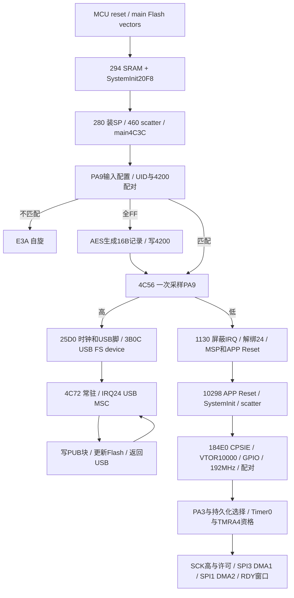

# 原厂 64 KiB Bootloader 合同、管脚归属与 USB MSC 生命周期

目标主控：`HC32F460JEUA`（ARM Cortex-M4F，小端，Bootloader 占 `[0x00000000, 0x00010000)`，APP 入口起点 `0x00010000`）。
依据：HC32F460 数据手册（DS Rev1.61）、参考手册（RM Rev1.5）、JEUA CMSIS 头文件及 Bootloader 向量/外设行为反汇编。

## 1. 原厂 64 KiB Bootloader 架构、PA9 分支门与 APP 交接合同

### 1.0 核心结论

1. **USB 与相机是 BL 中一次 PA9 采样选出的两条启动分支。** PA9=0 经 `4C60→1130→114E BLX [10004]` 进入 APP；PA9≠0 完成 USB 初始化后停在 `4C72: B 4C72`，服务由 IRQ24 驱动。
2. **USB D−/D+ 是 PA11/PA12，JEUA 第32/33脚；APP 复用它们的是 SPI1 独立 hotline/状态通道。** 主 Z 命令通道是 SPI3：PB13/MISO、PB14/SCK、PB15/MOSI；PA9/第30脚成为 RDY。
3. **正常 USB 业务完成后继续运行 BL USB。** 原生重放覆盖 user callbacks、USB reset/suspend/wakeup/enumeration/session、MSC reset、SCSI START_STOP_UNIT/ALLOW_MEDIUM_REMOVAL、描述符及媒体操作。重新复位并在启动采样时令 PA9=0，才走原厂相机入口。USB 总线 reset 与 MCU reset 是不同事件。
4. **BL 的 APP 门只装载两个向量。** 空 APP 与“仅向量有效、其余为空”的明确数据场景均到达 `114E`。原厂正常 APP 使用有效栈/入口并自行执行第二次 UID 配对和完整初始化。
5. **升级器消费的是连续块流。** 识别16B `PRODUCTVER:1.001` 后擦掉 `[10000,80000)`，跳过包头，把后继连续 LBA 写入 Flash。文件长度、文件名、版本和 APP 校验不参与这个媒体 writer 的结束判定。


### 总流程



### 1.1 Flash/RAM 布局及启动来源

|区域|实际归属与消费者|
|---|---|
|`0..27F`|BL 向量表；首SP=`1FFFD0D0`，Reset=`295`。公共异常入口自旋；外部 IRQ 向量进入 RAM callback 包装器。|
|`280..3FF`，`420..41EF`，`4210..5B8B`|BL 代码与紧邻 literal pools/字符串。代码与池按真实引用区分；线性输出中的“指令”本身不用于证明池内是代码。|
|`400..41F`|硬件 ICG，八word全部 `FFFFFFFF`。|
|`41F0..41FF`|AES128 配对常量；APP `18554..18563` 内容相同。|
|`4200..420F`|配置后的16B配对密文；原消费者 `1114`、APP `13FD0`。|
|`5B8C..5EA7`|PUB header、FAT boot sector、FAT/目录/README模板、SCSI inquiry等常量。|
|`5EA8..5EC7`|两条BL scatter记录：`(5EC8,1FFF8000,148,484)`、`(5F84,1FFF8148,4F88,2196)`。|
|`5EC8..5F83`|压缩的BL RAM初值；实际解压消费者484展开328B，含媒体、用户、USB驱动和MSC函数表。|
|`A000..A7FF`|原厂 Bootloader 保留文本配置窗口；`PA3` 高且 `0x4000` 标识匹配时由 `13BA0` 解析。|
|`10000..1BBAB`|原厂V120 APP，向量SP=`1FFFE780`、Reset=`10299`；`11000..11003=[20,01,03,26]`，USB README消费版本/日期字节。|
|`1B9EC..1BA0B`|APP scatter：`(1BA0C,1FFF8000,328,10628)`、`(1BBAC,1FFF8328,6458,1843C)`；808B初值和25688B零区。|
|`10000..` 末端边界|无文件结束标记；writer 进入 `phase=2` 后按连续 LBA 持续接收后续扇区直到 SCSI Eject。|
|`30000..3004F`|原厂 APP `PA3` 低电平支路读取的 `80 B` 状态缓存窗口（空环未写入时保持全 `0xFF`）。|
|`3E000..3FFFF`|8 KiB、2048 个 word 的原厂 APP 配置 journal 扇区（本开源固件将该双扇区日志规范至 `0x7C000..0x7FFFF`）。|

BL RAM：`1FFF8000..8147`初值；`8148..D0CF`零区；初始栈顶D0D0。USB device实例8178；RAM磁盘`867C..9A7B`共10扇区；IRQ回调表自`9A7C`开始；MSC数据buffer=`9C7C`、上限`3000`字节；CBW=`CC7C`、CSW=`CC9C`。

### ICG 的实际意义（RM162–167）

`ICG0=FFFFFFFF`：WDTAUTS/SWDTAUTS=1，两个看门狗在复位后停止；其计数分频字段的保留编码不构成正在计时的看门狗。`ICG1`：HRCSTOP=1，HRCFREQSEL=1（HRC选择16MHz但停止）；BORDIS=1；NMIICGENA=1（NMI pin ICG配置禁止）。`ICG4/5`均不同于安全等级1/2的使能魔数，属于等级0。2/3/6/7保留字段全1。该器件普通复位时钟起点是MRC；BL原生轨迹以8MHz MRC输入重放。

### 从 Reset 到 main

`294`先以`40050804/0C=77`解锁SRAM等待寄存器，写`40050800=1100`，随后写76保护；`2BE BLX20F8`使能CPACR CP10/11并调用`200C`读取当前时钟、形成SystemCoreClock，正常返回`2C0`。`2C2 BX280`，`280`重装SP=D0D0，`284→460`执行两条scatter，再经`288 BX4C3C`进入main。

真实 POR 模型的核心输入为 privileged Thread/MSP，CONTROL/IPSR/BASEPRI/FAULTMASK/PRIMASK=0，VTOR=0；SRAM零值是明确的初始输入，之后由原scatter形成状态。BL正常相机路径保持MRC、XTAL停止、PLL停止；RMU_RSTF0的PORF由输入提供，路径按原指令保留它。

### 1.2 配对、选择与 APP 交接

`4C3C→1158`把PA9设为数字输入、FSEL0、无软件上拉；`3EA`打开AES时钟；`10F4`读取`40010450/54/58`三word UID，第四word=FFFFFFFF；`1114`读4200四word。

`DC0`有三种结果：

- 四 word 全 `FF`：`DEA -> 578` 加密 `UID || FFFFFFFF`，`DF6 -> 10B2(4200, buffer, 4)` 编程 `16 B` 配对密文后返回。
- 已配置且四word解密结果全部相等：`E3C`返回。
- 任一 word 解密不相等：`E38 -> E3A` 停机自旋。

配对成功后 `4C56→1D1C`读取PIDRA bit9，`4C5A`分支。选择读是一次性操作，USB常驻循环里没有重新采样PA9的选择逻辑。

### 交接合同（原始34B函数1130）

1. `1134 CPSID I`。
2. `1138→2578(24)`解除INT_SEL24与RAM回调绑定；这与“关闭USB PHY/时钟”属于不同寄存器动作。
3. `113C`读`[10004]`并暂存到`1FFF8008`；`1142`读`[10000]`；`1144 MSR MSP,R0`。
4. `114E BLX R0`调用取出的APP Reset，返回地址LR=1151。正常原生观察：PC=10298、MSP=1FFFE780、PRIMASK=1、CONTROL/PSP/IPSR/BASEPRI/FAULTMASK=0、VTOR=0。


**失败/返回的含义：** 空向量场景到114E时R0=FFFFFFFF；仅向量有效场景R0=10299。它们展示选择与装载行为，物理Fault的具体帧由ARM硬件决定。`1150 POP {r4,pc}`使用已切换后的栈；原厂APP以自己的永久主循环运行，因此APP返回不构成一条具备栈恢复合同的升级入口。若人为调用1130时USB已开，函数本身保留USB门控/PHY和DDIS；这与正常可达的相机分支交接不同。

### 1.3 USB脚、PHY和外设拥有者


- `25D0→694`：配置XTAL，MPLL M=2/N=50/P=2，16MHz晶振下HCLK=200MHz；`2128`配置UPLL M=4/N=84/P=Q=R=7，得到48MHz，UPLLCFGR=`66605303`；`A4A`写`40054024`一字节`B0`选择UPLLP。
- `25F2/25FE→1D3C`，mask800/1000：PA11/PA12 PCR.DDIS=1；最终配置位8000。原PCR store PC=`1DE8`，16bit。`260C/261A/2628→1E20`分别将PA9/PA11/PA12 FSEL设10；store PC=`1E50/1E62`，16bit，BFE=0。
- PA9数字输入成为USBFS_VBUS；PA10/USBFS_ID保持原状态。`3D78`强制FDMOD=1，所以USB角色独立于ID脚。
- `2630→1EB8`清FCG1 bit8使能USB，PC1EC4向`40048004`写32bit `FFFFFEFF`；`3B12→4680`建立400C0000控制器、800设备寄存器、900/B00端点和1000起FIFO窗口。
- `3B94`暂清GAHBCFG全局IRQ使能；`27EA`两次CSRST并等待AHB idle/reset完成；`3BEE`设置PHYSEL。按官方GUSBCFG reset=A00，原写轨迹为A40，随后40000A40；枚举完成handler进一步设TRDT=9。
- `2F98`写DCFG=`08200003`（原reset保留位+DSPD=3，48MHz PHY的全速设备）；`307A`清DCTL.SDIS；`3BC6`置GAHBCFG.GINTMSK=1。DMAEN保持0，真实FIFO路径以CPU load/store搬运，跟APP的DMA1/DMA2是不同拥有者。
- GVBUSCFG保持0：VBUSOVEN/VAL的override路径处于复位值，PA9的VBUS输入有效。内部FS PHY负责DM/DP和设备连接；外部连接电平、上拉实际波形通过官方“VBUS有效/SDIS清零”的条件解释。
- RX FIFO=128word；EP0 TX起点128、64word；EP1 TX起点192、64word；EP2 TX起点256、64word；3..5深度0。MSC class初始化`5A28`打开bulk IN81/OUT01，maxpacket64B，并准备31B CBW。

官方pad规则：DS34–36将PA9/PA11/PA12的Func10列为VBUS/DM/DP，PA11/12的FuncGrp1又提供SPI1。RM201规定DDIS=0时GPI始终可读，RM210规定DDIS=1关数字功能，RM204说明DM/DP脚各有约400kΩ常驻下拉。原BL同时配置模拟模式和Func10；APP的SPI数字路径要满足DDIS=0。

### 1.4 APP成为正常 Z 接口的实际过程

`10298`重做SRAM保护/等待；`102C2→1719C→170B0`使能FPU并查询时钟，返回；`102C6→10280`重装当前SP；`10604`执行APP scatter；`10288→184E0`。

`184E0 CPSIE I`先于`184E8 VTOR=10000`；正常BL相机路径提供安静的外设中断状态。`1091C`配置PA9/PA2/PA1输出、PA3上拉输入、PA0/PH2/PB14输入；PA11/12沿用数字复位PCR。`1084A`建立192MHz APP时钟；`11164`再次读取实际UID、4200配对记录并比较，成功到111B2，失败停111B0。

`109D4(30)`配置Timer0_2A、IRQ45，PCLK1=96MHz、除32、比较29，原计时tick=10µs。`10B18`配置TMRA4/channel8/PC13 Func4，IRQ80；`133CC/15510/14C10`形成队列、帧模板、状态0。

主循环 `1850E→160D0`：

- `PA3` 高：`13F74` 比对 `0x4000` 的 `16 B` 标识，不匹配时选择缺省 preset `6`，匹配时解析 `0xA000` 文本配置；`13FE4` 扫描并恢复 `0x3E000` journal，设置启动许可 `823B` 与模式字段。
- `PA3` 低：从 `0x30000` 读取 `80 B` 缓存并启动 `TMRA4`，经六次 `IRQ` 溢出与 `15838` 条件形成 `823B`；`PA0/1`、`PA2`、`PH2` 作为独立 E 侧握手/USART 链共同约束该分支状态。
- state1同时要求PB14/SCK高、800A≥1000（约10ms tick累计）、823B≠0；接着 `15208` DMA1，`15164` SPI3，`15308` SPI1，`153C4` DMA2。
- `161C2`将PA9置高，清计时；50个10µs tick后`161E6`拉低，形成约500µs首高脉冲。实际明确输入下499.24µs，差额来自tick相位和指令执行。
- 主Z header由SPI3/DMA1接收4个16bit word；`12730`解析/组帧。完成阶段拉高RDY，原SysTick等待10µs并重装DMA，再拉低开放响应窗口。SPI1热线是独立42B状态发送链，复用USB的PA11/12。


### 1.5 USB、升级和持久化


- 无文件结束状态：最后一批PUB返回后phase仍为2，连续后继块继续写入；SCSI eject是成功返回路径。
- RAM媒体边界：`LBA<10`分支按整批block count复制；LBA9/count2在实际媒体consumer中覆盖了`1FFF9A7C`开始的IRQ callback区。该异常输入改变间接调用目标，须与正常静态表路径分别记录。


---

## 2. QFN48 13 关键管脚逐阶段归属矩阵


|JEUA脚|MCU pad|复位/BL相机选择|BL USB|相机分支APP边界|APP正常用途|
|---:|---|---|---|---|---|
|30|PA9|PCR0/FSEL0，4C56采样|PCR0/FSEL10，USB VBUS|仍是输入|PCR2/FSEL0，Z RDY；1094E，161C2/161E6|
|31|PA10|数字GPIO|保持GPIO；FDMOD强制device|复位配置|保持GPIO|
|32|PA11|PCR0/FSEL0|PCR8000/FSEL10，USB DM|PCR0/FSEL0|PCR0/FSEL43，SPI1 hotline SCK；1532A|
|33|PA12|PCR0/FSEL0|PCR8000/FSEL10，USB DP|PCR0/FSEL0|PCR0/FSEL40，SPI1 hotline MOSI；15338|
|26|PB13|数字GPIO|保持|复位配置|SPI3 MISO，FSEL41；151A2|
|27|PB14|数字GPIO|保持|复位配置|启动SCK采样16194，SPI3 SCK FSEL43；15186|
|28|PB15|数字GPIO|保持|复位配置|SPI3 MOSI FSEL40；15194|
|13|PA3|数字GPIO|保持|复位配置|PCR40/FSEL0，上拉输入选择；10938、160EC|
|10|PA0|数字GPIO|保持|复位配置|E RX，首次高PA3空E路径FSEL0；16870以后USART1_RX/FSEL33|
|11|PA1|数字GPIO|保持|复位配置|E TX GPO；16870以后USART1_TX/FSEL32|
|12|PA2|数字GPIO|保持|复位配置|E握手输出PCR2；10962|
|1|PH2|数字GPIO|保持|复位配置|E握手输入；109B2|
|2|PC13|数字GPIO|保持|复位配置|TMRA4_PWM8 Func4；低PA3启动资格的计时链|

表中FSEL十进制与CSV十六进制对应：10=A，40=28，41=29，43=2B。共享寄存器基址PORT=`40053800`；PCR基址=`40053C00`，port stride40、pin stride4，PFSR=PCR+2；PH端口索引5。

USB选择调用：25F2/25FE→1D3C，PCR最终写者1DE8；260C/261A/2628→1E20，PFSR写者1E50/1E62。APP公用PCR helper写者1563A/1564E，FSEL写者15740/15752。

**拥有者分界：** 正常相机分支的交接发生在USB初始化之前。APP对PA11/12的设置以数字复位PCR为前提；USB阶段的DDIS=1属于另一条启动路径。MCU reset按官方GPIO复位规则恢复该前提。

来源：DS Rev1.61 p33–36的JEUA/LQFP-QFN48列及FuncGrp表；RM Rev1.5 p200–211的GPIO规则。固件配置事实与封装脚号已对应；升级盖/PCB触点网名由连接照片或连续性记录补齐。操作说明中的“升级镜头盖接USB”是接法来源。

---

## 3. USB MSC 虚拟 FAT12 磁盘与连续扇区写入状态机

### 3.1 USB身份及主机视图


- USB2.00、EP0=64B、VID=`2E88`、PID=`4601`、bcdDevice=`0200`。
- 字符串：`HDSC`、`MSC Device`、`00000000050C`、`MSC Config`、`MSC Interface`；语言0409。
- 配置32B：一个接口，MSC class08/subclass06/SCSI、protocol50/BOT；bulk IN81与OUT01，64B。属性C0、MaxPower32（100mA，描述符字段）。
- SCSI media函数表 `1FFF8040`：init5006、capacity4F58、write-protect4FE4、ready4FE8、read500C、write5070、max-LUN5000；inquiry来源5DA6。

`4F58`每次GetCapacity均读取APP `11000`一word、清空RAM磁盘1400B、复制原模板并格式化README。容量906×512B；BPB：1 sector/cluster、1 reserved sector、1 FAT、4 sectors/FAT、16 root entries。根目录LBA5；README cluster2，从LBA6起、目录长度2048B（4扇区）；LBA10是新文件可开始的数据区。

README实际内容：

```text
ProductName: BORYOZA SONY E TO NIKON Z ADAPTER

Hardware Version: V2.04
Software Version: V1.20
UpGrade Date:     2026-03
```

ProductName/Hardware是BL `5E04`格式字符串常量；软件版本/日期来自实际APP版本word `[20,01,03,26]`，由 `4FA8..4FC0`传给格式化器。GetCapacity再次执行会重新生成RAM文件视图。README是版本word的显示消费者，升级器的payload完整性属于另一个条件。

LBA<10的read把RAM磁盘字节复制到主机buffer；LBA≥10的read调用`108C`从 `10000+(requestedLBA-[1FFF8064])*512`读Flash。8064在初始值时为10，升级过程中却成为“期望下一LBA”；因此这个映射会随writer进度改变，写入后的磁盘read不等同于PUB payload逐字节读回。

### 3.2 写入状态机与出错行为

真实媒体writer `5070` 参数由 `53FC/5440..5450`的MSC层提供：LUN、buffer、LBA、block count。MSC数据分段上限3000B=24扇区。上游 `5174`核LBA+count与906块容量，底层writer另外维护如下RAM状态：

|地址|作用|
|---|---|
|1FFF8060 byte|phase：0初始、1已识别头/待首写、2连续写|
|1FFF8064 word|初始10；识别头后为该LBA；首写后为期望下一LBA|
|1FFF8068 word|Flash目的地址；识别头后10000，写后累加实际payload字节|
|1FFF806C byte|媒体访问状态位，read/write/ready各置位|

每次写回调先用 `508C..509A`比较buffer起始16B与 `5B8C`的 `PRODUCTVER:1.001`。相等就重新设置phase1、当前LBA和目的10000；识别发生在LBA分支之前。

1. **LBA<10：** `50B8..50CA`把整批 `blocks*512` 字节复制到 `867C+LBA*512`，返回0。判断只依据起始LBA；LBA9/count2的实际原指令覆盖IRQ callback区9A7C起的512B。该输入处于906块容量内，也小于MSC的24块分段上限。读路径具有同样的“按起始LBA选择”边界。
2. **LBA≥10、phase1：** `50DA..50EC`循环56次擦8KiB扇区，10000、12000……7E000。`50FC`从buffer+16写 `blocks*128-4` 个word；phase=2，目的前移 `blocks*512-16`，期望LBA加blocks。
3. **phase2且LBA恰好等于期望值：** `513A`从buffer写 `blocks*128` 个word；目的和期望LBA前移。
4. **初始错误头/phase0，或phase2跳号LBA：** 走5154返回0，状态和已编程内容保留。这个返回值可被MSC当成成功。
5. **再次识别有效header：** phase重置到1，下一次数据区分支再次全擦APP及高Flash。header中没有payload长度字段。

Flash helper ``1064 -> F18``、``10B2 -> FBC``运行原EFM解锁/模式/cache/写保护流程；扇区擦除的触发store为F54，逐word程序store为FF8。helper包含busy/timeout状态；5070在调用后继续更新phase/LBA并最终返回0，返回错误与主机成功反馈的关系以这层实际consumer为准。


### 3.3 包尾、eject、reset、重连

writer持续保持phase2，它的输入中没有文件长度/包尾完成标记。48060B PUB占94扇区，写后目的`1BBF0`、期望LBA104。若下次提交LBA104，后继内容仍按payload写入。

- `5198`的SCSI dispatch把1B/1E都交给57E4；该函数将MSC待传长度置0、R0=0、BX LR。START/LOEJ相关flags四种组合的原生结果一致。
- 七个user callback（reset/suspend/resume/connect等表槽）全部BX LR；core/class reset处理端点/地址/BOT状态后返回。
- USB device主循环4C72常驻；IRQ24负责继续枚举/MSC。GPIO PA9在该循环之外完成启动选择。
- GINTSTS bit29的单独输入被原始GINTMSK屏蔽；它的replay属于“按真实mask返回”场景。物理VBUS消失如何影响供电/PHY，用电源连接记录与RM设备连接条件判定。
- MSC BOT reset归位BOT传输状态；writer的8060/64/68属于另一个状态对象。GetCapacity重建RAM磁盘和README，版本显示取决于调用时的11000。

因此，主机 eject 是升级文件传输流程的完成操作，APP进入需要后继MCU复位+相机选择输入。MCU硬件支持的软件系统复位可以回到向量入口；本原厂正常USB函数表/控制流里的总线事件保持USB职责。物理拔插是否产生MCU复位由升级盖供电线路决定。

### 3.4 `phase = 2` 连续写入无文件尾标记的行为特征

- `PRODUCTVER:1.001` 容器头本身只包含 16 字节魔数标识，**不包含载荷总长度字段**；因此媒体 writer `0x5070` 在进入 `phase = 2` 后没有隐式 EOF 状态，后续提交到连续期待 LBA 的所有扇区都会按载荷继续写入 Flash，直到主机执行 SCSI `Eject`（`0x1B / 0x1E`）结束传输。
- 因此，向原厂 Bootloader 刷写新固件时必须在最后一扇区补齐 `0xFF`（详见 [`pack_pub.py`](../../se-nz/tools/pack_pub.py) 与 [`flash_usb_bor.py`](../../se-nz/tools/flash_usb_bor.py)），防止桌面操作系统后台元数据或跨目录分簇写入污染 APP 尾部，并在大镜像验证前通过 MCU 复位重新进入 USB MSC 恢复 `LBA >= 10` 映射基准。

### 3.5 再次启动与journal/cache

APP `13FE4`扫描3E000的2048word：遇FFFFFFFF时取上一条；首槽就是FF时把当前缺省配置word写入首槽；全满时取3FFFC，擦3E000扇区再写回该word。下一写位置保存在1FFF801C。

`PA3` 高且 `0x4000` 标识不匹配时 preset 为 `6`（写 `0x06000000` 至 journal 首槽），之后按 `13FE4` 扫描并到达首次 Z 响应。

`PA3` 低读取 `0x30000` 的 `80 B` 缓存；`PA3` 高且特定旧 `0x4000` 标识匹配时读取 `0xA000` 配置文本（默认两者均保留全 `0xFF`）。原厂 APP 的内建表位于代码常量区，RAM 初值由 scatter 生成，协议响应由 CPU 更新后经 SPI/DMA 发送。

### 3.6 后续设计需要承接的原厂事实

启动门、升级完成、版本显示、持久化恢复、USB连接和Z首窗口分别有自己的真实消费者；这里的地址/场景可以逐项用于新设计的合同与差分输入。原始代码行为中的连续LBA依赖、跨RAM边界、错误返回传播和尾部写入都作为明确事实保存。
